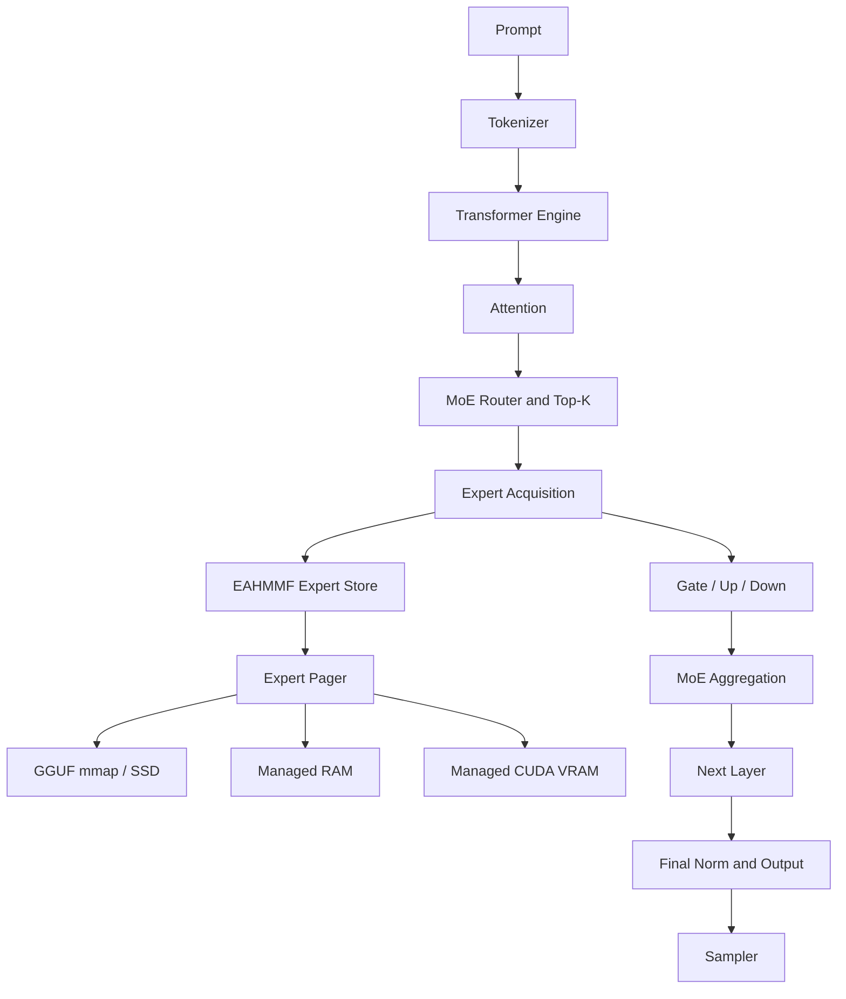

# EAHMMF
## Expert-Aware Hierarchical Memory Management for Qwen3-MoE Inference

EAHMMF is a C++17 Qwen3-MoE GGUF inference engine with an expert-aware hierarchical memory manager. It manages expert-weight residency across three tiers:

- **SSD:** immutable, memory-mapped GGUF backing.
- **RAM:** managed host-memory copies.
- **VRAM:** managed CUDA device-memory copies.

The model router selects experts. EAHMMF manages the residency and movement of the selected expert weights; it does not replace or modify routing.

## Contents
- [Overview](#overview)
- [Inference engine](#inference-engine)
- [EAHMMF design](#eahmmf-design)
- [CUDA implementation](#cuda-implementation)
- [Build](#build)
- [Run](#run)
- [Validation](#validation)
- [RTX 3050 experiment](#rtx-3050-experiment)
- [Repository layout](#repository-layout)
- [Limitations](#limitations)
- [License](#license)

## Overview

Large Mixture-of-Experts models can contain more expert weights than fit in a constrained GPU's VRAM. EAHMMF stages expert weights between the GGUF backing file, host RAM, and GPU VRAM as inference requests them.



## Inference engine

The main inference engine is implemented in `qwen3moe.cpp`.

### GGUF loader
- Opens the model read-only and maps it with `mmap`.
- Supports GGUF versions 2 and 3.
- Parses metadata and tensor descriptors, including names, dimensions, types, and offsets.
- Uses GGUF alignment metadata, defaulting to 32 bytes.
- Validates dimensions, block alignment, and file bounds.
- Retains direct pointers and offsets into the mapped model.
- Supports scalar and array metadata; nested metadata arrays are unsupported.

### Tensor and quantization operations
The CPU implementation supports F32, F16, BF16, Q4_0, Q4_1, Q5_0, Q5_1, Q8_0, Q4_K, Q5_K, and Q6_K. It includes F16 conversion, quantized block decoding, tensor row access, dot products, matrix multiplication, and RMS normalization.

CPU format support is broader than CUDA expert-compute support; see [CUDA implementation](#cuda-implementation).

### Tokenizer
The tokenizer implements GPT-2 byte-to-Unicode mapping, Qwen-style pre-tokenization, UTF-8 processing, Unicode letter/number category handling, BPE merge-rank lookup, and special-token parsing. It reads token and merge data from GGUF metadata.

The implementation expects the GPT-2 tokenizer model and recognizes `qwen2` and `qwen35` pre-tokenizer metadata values, using the Qwen2-style splitter. `unicode_tables.h` is generated by `gen_unicode.py`.

### Transformer forward pass
The engine targets the `qwen3moe` architecture. It loads model dimensions and tensors, initializes RoPE frequencies, KV cache storage, and activation buffers.

Each layer performs:
1. Input RMS normalization.
2. Query, key, and value projections.
3. Query/key normalization and RoPE.
4. KV cache update.
5. Causal grouped-query attention and softmax.
6. Attention output projection and residual addition.
7. MoE input normalization and router scoring.
8. Softmax and top-k expert selection.
9. Expert gate/up projections, SiLU gating, and down projection.
10. Router-weighted expert aggregation and residual addition.

The engine then applies final normalization and output projection. The sampler supports temperature, top-k, top-p, min-p, repetition penalty, greedy decoding, and explicit seeds.

Default sampler values: temperature `0.7`, top-k `20`, top-p `0.8`, min-p `0`, repetition penalty `1.05`, repetition window `64`.

## EAHMMF design

The framework is implemented in `eahmmf.h`.

| Component | Responsibility |
|---|---|
| `ExpertDescriptor` | Expert identity, tensor slices, shapes, byte counts, residency, pointers, masks, pin count |
| `ExpertStore` | Acquisition/release, budgets, residency accounting, eviction selection, statistics |
| `ExpertPager` | Staging, migration, eviction, device-memory release |
| `ExpertLease` | Move-only RAII ownership of an acquired expert |
| `WeightView` | Exposes weight views for computation |
| `DeviceBackend` | Abstract allocation, copies, synchronization, memory information |
| `SimDevice` | Simulated device backend for tests |
| `CudaDevice` | CUDA device-memory backend |

### Residency and migration

Supported transitions:

| Transition | Operation |
|---|---|
| SSD → RAM | Allocate host memory and copy the three expert components from GGUF backing |
| RAM → VRAM | Allocate device memory and copy expert components to GPU |
| VRAM → RAM | Copy device data back to managed host memory |
| RAM → SSD | Release RAM copy; immutable GGUF backing remains valid |
| VRAM → SSD | Release VRAM copy and return to GGUF backing |

Migration is staged transactionally: begin transition, allocate, copy, synchronize if required, validate when enabled, publish destination residency, then release the old copy. A failed migration frees the partial destination and preserves the previous valid copy.

`--expert-verify` enables checksum validation. The pager uses LRU reclamation of unpinned experts. VRAM reclamation first attempts VRAM-to-RAM; if RAM cannot accept the copy, the VRAM copy can be dropped to SSD backing. Physical free memory and `--vram-reserve-mb` are considered, and bounded reclamation/retry is attempted after a physical allocation failure.

### Leases and invariants

`ExpertLease` is move-only and pins an expert while it is in use. Pinned experts cannot be evicted or manually promoted/demoted. The invariant checker covers descriptor state, validity masks, RAM/VRAM accounting, exclusive residency, pin counts, bounce-buffer ownership, and pool capacities.

CUDA device memory is not CPU-readable. The CPU path can use a host bounce buffer populated by device-to-host copies; it is associated with the active lease and released when the relevant pin is released.

## CUDA implementation

CUDA code is in `expert_cuda.cu`.

### CUDA expert formats

| GGUF type ID | Format |
|---:|---|
| 8 | Q8_0 |
| 12 | Q4_K |
| 13 | Q5_K |
| 14 | Q6_K |

Do not assume all CPU-supported formats are supported by CUDA expert computation.

### Kernels
- `expert_matmul_kernel`: general kernel; one CUDA thread computes an output element by decoding quantized weights and calculating a dot product.
- `expert_matmul_warp_kernel`: one warp processes one output row; each lane handles eight weights per 256-value superblock and reuses decoded metadata. Requires the input dimension to be divisible by 256.

The wrapper selects the warp kernel when the dimension is divisible by 256, unless `EAHMMF_OLD_KERNEL` is set; otherwise it uses the general kernel.

### Paired gate/up projection
`eahmmf_cuda_matmul_pair` performs one activation H2D transfer, two expert matmul launches, two output D2H transfers, and one stream synchronization. Scratch buffers persist and grow on demand.

CUDA accelerates supported expert matrix multiplications; this is not a fully GPU-resident transformer. Activations and results cross host/device memory, and surrounding inference operations remain in the host-side engine. `--cuda-shadow` compares GPU expert matmul against the CPU result.

## Build

### Requirements
- Linux, GNU Make, G++ with C++17 and OpenMP.
- For CUDA: NVIDIA CUDA Toolkit and an NVCC-compatible host compiler.
- Python 3 and test dependencies: NumPy, `gguf`, and `regex`.

### Validation machine
- AMD Ryzen 7 7435HS
- NVIDIA GeForce RTX 3050 Laptop GPU, 4 GB
- 23 GiB RAM
- Fedora Linux 44
- CUDA Toolkit 13.2
- NVCC host compiler `/usr/bin/g++-15`

These are the validation-machine specifications, not minimum requirements.

### CPU build
```bash
make clean
make -j$(nproc)
```

### CUDA build
The Makefile defaults to `/usr/local/cuda` and `/usr/bin/g++-15`:
```bash
make clean
make CUDA=1 -j1
```

For a custom CUDA path:
```bash
make clean
make CUDA=1 CUDA_HOME=/path/to/cuda -j1
```

Run `make clean` when switching CPU/CUDA configurations.

## Run

The executable is `qwen3moe`.

One-shot:
```bash
./qwen3moe -m model.gguf -p "Explain mixture of experts."
```

Interactive:
```bash
./qwen3moe -m model.gguf -i
```
Interactive commands: `/reset`, `/exit`, `/quit`.

Raw prompt:
```bash
./qwen3moe -m model.gguf --raw -p "Your prompt here"
```

CUDA expert compute:
```bash
./qwen3moe -m model.gguf --device cuda --expert-tier vram --cuda-compute -p "Explain transformers."
```
`--cuda-compute` requires a CUDA-enabled build, `--device cuda`, and `--expert-tier vram`.

CUDA shadow comparison:
```bash
./qwen3moe -m model.gguf --device cuda --cuda-shadow -p "Test CUDA expert computation."
```

### CLI options

| Option | Description |
|---|---|
| `-m FILE` | GGUF model |
| `-p TEXT` | One-shot prompt |
| `-i` | Interactive mode |
| `-s TEXT` | System prompt |
| `--raw` | Disable ChatML template |
| `-n N` | Max new tokens; default 1024 |
| `-c N` | Context; default 8192, limited by model training context |
| `-t N` | CPU threads; default OpenMP thread count |
| `-b N` | Prefill batch 1–64; default 32 |
| `--temp F` | Temperature |
| `--top-k N` | Top-k |
| `--top-p F` | Top-p |
| `--min-p F` | Min-p |
| `--repeat-penalty F` | Repetition penalty |
| `--seed N` | Random seed |
| `--device sim\|cuda` | Device backend |
| `--expert-tier ssd\|ram\|vram` | Expert residency tier |
| `--ram-budget-mb N` | Managed RAM budget |
| `--vram-budget-mb N` | Managed VRAM budget |
| `--vram-reserve-mb N` | Physical VRAM reserve |
| `--expert-verify` | Verify migrations by checksum |
| `--expert-strict` | Fail instead of fallback |
| `--expert-log FILE` | Residency event log |
| `--expert-stats` | Print residency statistics |
| `--cuda-shadow` | Compare GPU matmul with CPU |
| `--cuda-compute` | Run supported expert matmuls on CUDA |
| `--populate` | Pre-fault mapped model |
| `--tokenize TEXT` | Print token IDs |
| `--pretok TEXT` | Print pre-tokenizer splits |
| `--logits-test 1,2,3` | Debug selected logits |

The default expert tier is SSD (zero-copy GGUF mmap backing).

Example constrained pools:
```bash
./qwen3moe -m model.gguf \
  --device cuda --expert-tier vram --cuda-compute \
  --ram-budget-mb 9216 --vram-budget-mb 3000 \
  --vram-reserve-mb 256 --expert-stats \
  -p "Describe a transformer."
```
These budgets are example settings from the RTX 3050 experiment, not universal recommendations.

## Validation

The repository contains:
- `tests/test_tiny.py` — tiny GGUF numerical checks.
- `tests/test_pretok.py` — randomized pre-tokenizer comparison.
- `check_baseline.sh` — logits and generation equivalence.
- `tests/test_eahmmf.cpp` — C++ residency and invariant tests.
- `tests/test_eahmmf_v1_stress.py` — stress-test harness.

The release validation used an isolated Python environment:
```bash
python3 -m venv ~/Documents/files/.venvs/eahmmf-release
source ~/Documents/files/.venvs/eahmmf-release/bin/activate
python -m pip install numpy gguf regex
```

Full CUDA verification:
```bash
make clean
make CUDA=1 -j1
make CUDA=1 check
```

Recorded results:

| Validation | Result |
|---|---|
| Tiny-model batch 1 | PASS; max absolute error `5.64e-07` |
| Tiny-model batch 4 | PASS; max absolute error `5.64e-07` |
| Tiny-model batch 64 | PASS; max absolute error `5.64e-07` |
| Randomized pre-tokenizer | 3,000 cases; 0 mismatches |
| Baseline logits | PASS; max absolute difference `1.00e-06` |
| Greedy generation | PASS; byte-exact |
| Seeded generation | PASS; byte-exact |
| C++ EAHMMF invariant suite | 204 checks; 0 failed |

The C++ tests cover descriptors, residency transitions, byte-exact migrations, nested pins, LRU eviction, pinned-expert protection, failed staging, physical VRAM pressure, invalid backing ranges, CPU bounce access, telemetry, lease ownership, and store reinitialization protection. Some tests intentionally trigger diagnostics for invalid releases and attempted reinitialization with outstanding pins; these are expected negative-test cases.

The CUDA build and full verification target completed successfully in the recorded release validation.

## RTX 3050 experiment

A real-GPU experiment used the CUDA-enabled engine and a Qwen3-MoE GGUF model.

| Setting | Value |
|---|---:|
| GPU | RTX 3050 Laptop GPU, 4 GB |
| CPU | Ryzen 7 7435HS |
| RAM | 23 GiB |
| OS | Fedora Linux 44 |
| CUDA Toolkit | 13.2 |
| CPU threads | 4 |
| Managed VRAM budget | 3,000 MiB |
| Managed RAM budget | 9,216 MiB |
| Physical VRAM reserve | 256 MiB |
| Requested generation target | 256 tokens/session |

Ten independent sessions were run. Per-session data is in `benchmarks/rtx3050_10_session_summary.csv`.

| Metric | Observed result |
|---|---:|
| Successful sessions | 10 / 10 |
| Elapsed time | 150.36–202.84 s |
| Mean elapsed time | 174.55 s |
| VRAM-resident experts | 853–858 |
| RAM-resident experts | 2,855–2,866 |
| SSD-resident experts | 2,422–2,435 |
| GPU expert matmul calls/session | 342,144–347,904 |
| Allocation failures | 0 |
| Allocation retries | 0 |
| Migration failures | 0 |
| CPU fallbacks | 0 |
| Outstanding pins at completion | 0 |

The first session's detailed log recorded 115,200 acquisitions and releases, maximum simultaneous pin count 1, 44,692 RAM-to-VRAM migrations, 43,838 VRAM-to-RAM migrations, 5,823 SSD-served acquisitions, and 345,600 GPU expert matmul calls. It recorded zero migration failures and zero CUDA allocation failures/retries.

The CSV field `generated_tokens_target` records the requested generation limit; it does not prove every session generated exactly that number of tokens. These are runtime observations, not a comparative benchmark. No speedup, throughput improvement, or latency reduction over a baseline is claimed.

## Repository layout

```text
EAHMMF-release/
├── qwen3moe.cpp
├── eahmmf.h
├── expert_cuda.cu
├── unicode_tables.h
├── gen_unicode.py
├── Makefile
├── check_baseline.sh
├── tests/
│   ├── test_eahmmf.cpp
│   ├── test_eahmmf_v1_stress.py
│   ├── test_pretok.py
│   └── test_tiny.py
├── baseline/
│   ├── gen_greedy.bin
│   ├── gen_seed42.bin
│   └── logits.txt
└── benchmarks/
    └── rtx3050_10_session_summary.csv
```

## Limitations

1. The loader targets Qwen3-MoE GGUF, not arbitrary transformer architectures.
2. GGUF versions 2 and 3 are supported; nested metadata arrays are not.
3. The tokenizer expects GPT-2 tokenizer data and uses the Qwen2-style pre-tokenizer.
4. RoPE scaling other than `none` is not implemented.
5. CUDA expert computation supports Q8_0, Q4_K, Q5_K, and Q6_K only.
6. CUDA accelerates expert matmuls; the full transformer is not GPU-resident.
7. Migration is synchronous; asynchronous prefetch is not implemented.
8. Persistent RAM and VRAM copies of the same expert are not maintained simultaneously.
9. EAHMMF does not predict, select, or change expert routing.
10. Learned expert prediction and predictive prefetch are not implemented.
11. CUDA scratch-buffer wrappers assume a single-threaded caller.
12. The included experiment is not a controlled comparison against another engine or memory policy.

Future research may investigate predictive expert placement, prefetching, asynchronous migration, transfer scheduling, and controlled performance comparisons. These are research directions, not implemented features in this release.

## License

Add the chosen license before public distribution. Until a license is included, users should not assume the source is licensed for unrestricted reuse.
